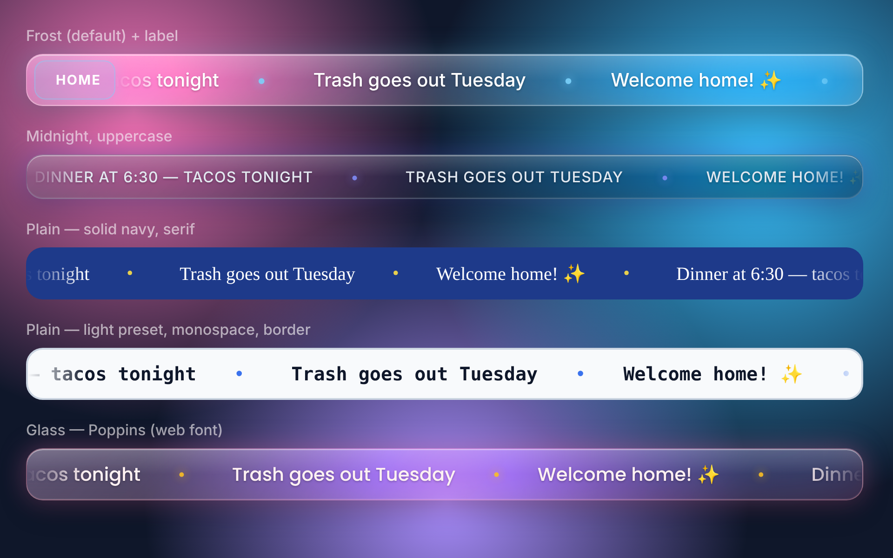

<div align="center">

# Grand Marquee

**A smooth, frosted-glass scrolling marquee for Home Assistant.**

[](https://hacs.xyz/docs/faq/custom_repositories)
[](https://www.home-assistant.io/)
[](CHANGELOG.md)
[](LICENSE)

</div>

Beautiful design and ease of use. https://github.com/Degederon/grand-marquee

Grand Marquee puts a rolling ticker of messages on your Home Assistant dashboard. It matches the look of [Glass Message Board](https://github.com/Degederon/GlassMessageBoard): frosted glass in any colour, or a plain solid bar if you prefer. Automations can post messages to it, live sensor values can scroll alongside them, and it can sit inside a dashboard or stay pinned to the top or bottom of the screen on a wall tablet.

## Contents

- [Features](#features)
- [Requirements](#requirements)
- [Step-by-step setup](#step-by-step-setup)
- [Dashboard configuration](#dashboard-configuration)
- [Actions](#actions)
- [Entities](#entities)
- [Automation examples](#automation-examples)
- [Troubleshooting](#troubleshooting)
- [Contributing](#contributing)
- [License](#license)

## Features

| Feature | Description |
|---|---|
| **Smooth scrolling** | Messages glide at a steady speed you choose, whatever their length, and loop with no visible seam. New messages join without the text jumping back to the start. |
| **Glass or plain** | Frosted glass with blur, sheen and glow, or a flat bar in exactly the colour you pick. |
| **Your colours** | Six presets (Frost, Aurora, Midnight, Rose, Ember, Light) plus colour pickers for the background, text, accent, edge and glow. |
| **Your font** | Your Home Assistant theme's font, System, Serif, Monospace or Rounded, ten web fonts such as Poppins and Orbitron, or any font name you type. |
| **Placement** | Inside a dashboard, or pinned to the top or bottom of the screen. |
| **Messages from automations** | Add, replace, remove or clear messages with actions. Messages can have an icon, a colour and a time limit, and survive restarts. |
| **Live values** | Scroll any entity's state, such as the outdoor temperature or the front door lock, next to your messages. |
| **Touch friendly** | Tap to pause and resume on a tablet; hover to pause on a computer. |

<p align="center">
  
</p>

### Architecture

A single installation provides two components:

- **Integration** (`grand_marquee`): stores and expires messages, and provides actions and a sensor.
- **Dashboard card** (`custom:grand-marquee`): the marquee itself, served by the integration and loaded on your dashboards.

## Requirements

- Home Assistant **2024.11** or later. On **2026.11** and later, install through the built-in **Marketplace**; on earlier versions, use **HACS**.
- A GitHub account, to add the repository to the Marketplace or HACS.
- Internet access on the display, only if you choose one of the web fonts.

## Step-by-step setup

Follow these parts in order. Each one only needs to be done once.

### Part 1: Install the integration

**Using the Marketplace (Home Assistant 2026.11 and later)**

1. Go to **Settings → Marketplace**.
2. The first time, read the community-content warning and confirm.
3. Choose **Add via link**, paste `https://github.com/Degederon/grand-marquee`, and choose **Integration** if asked. You may be asked to connect your GitHub account.
4. Open **Grand Marquee** and select **Install**.
5. Restart Home Assistant: **Settings → System**, select the power icon (top right), then **Restart Home Assistant**.

**Using HACS (earlier versions)**

1. In HACS, open the menu (⋮) and select **Custom repositories**.
2. Paste `https://github.com/Degederon/grand-marquee`, choose the category **Integration**, and select **Add**.
3. Search for **Grand Marquee** and install it.
4. Restart Home Assistant.

**Manual installation**

1. Download the latest release.
2. Copy `custom_components/grand_marquee` into your `config/custom_components/` folder.
3. Restart Home Assistant.

### Part 2: Turn on the integration

Downloading the integration is not enough; it also has to be added.

1. Go to **Settings → Devices & services**.
2. Select **+ Add integration** (bottom right).
3. Search for **Grand Marquee**, select it, then select **Submit**.

To confirm it's working, open **Grand Marquee** on the **Devices & services** page. You should see a device with a **Messages** sensor.

### Part 3: Load the marquee's display file

This happens automatically: the integration adds the marquee under **Settings → Dashboards → Resources** and keeps it on the current version after every update. You don't need to do anything.

> [!TIP]
> To check that the file is reachable, open your Home Assistant address followed by `/grand_marquee/grand-marquee.js`, for example `http://homeassistant.local:8123/grand_marquee/grand-marquee.js`. You should see a page of code.

### Part 4: Add the marquee to a dashboard

1. Open the dashboard, select the pencil (top right) to edit it.
2. Select **+ Add card**, search for **Grand Marquee** and select it.
3. Pick a **Style** and **Color preset**, then open **Colors**, **Font** and **Layout & placement** to adjust anything you like. The preview updates as you go.
4. Select **Save**.

> [!NOTE]
> If you choose **Pinned to top of screen** or **Pinned to bottom of screen**, the marquee stays in place while you edit the dashboard so you can still select it. It moves to the edge of the screen when you select **Done**.

### Part 5: Post your first message

1. Open **Developer tools** in the sidebar and choose the **Actions** tab.
2. Choose **Grand Marquee: Add message**, type some text, and select **Perform action**.
3. The message appears on the marquee straight away.

## Dashboard configuration

Everything below can be set in the card editor. To edit it as YAML instead, open the card's **⋮** menu and choose **Edit in YAML**.

```yaml
type: custom:grand-marquee
title: Home              # optional label on the left
title_icon: mdi:home
style: glass             # glass | plain
theme: aurora            # frost | aurora | midnight | rose | ember | light
font_family: poppins
speed: 70                # pixels per second
position: bottom         # inline | top | bottom
entities:
  - sensor.outdoor_temperature
  - entity: lock.front_door
    name: Front door
    icon: mdi:door
messages:
  - Welcome home ✨
```

| Option | Default | Description |
|---|---|---|
| `entity` | `sensor.grand_marquee_messages` | Where messages come from. Any entity with a `messages` attribute works; for other entities the state is shown. Set to `""` to turn off. |
| `messages` | – | Messages that are always shown: text, or `{text, icon, color}`. |
| `entities` | – | Entity states to scroll: an entity ID, or `{entity, name, icon, color}`. |
| `style` | `glass` | `plain` gives a flat bar in exactly the colour you choose, without blur, sheen, glow or shadows. |
| `theme` | `frost` | Colour preset. Each preset also has its own solid colour for the plain style. |
| `tint_color`, `text_color`, `accent_color`, `border_color`, `glow_color` | from preset | `"#7dd3fc"`, `"125,211,252"` or `[125, 211, 252]`. In the plain style `tint_color` is the background. |
| `tint_opacity`, `glow_strength` | from preset | 0 to 1. The plain style is fully opaque unless you change it. |
| `border_width` | 1 (glass), 0 (plain) | Pixels. |
| `blur` | 18 | Background blur in pixels (glass only). |
| `font_family` | `theme` | `theme`, `system`, `serif`, `mono`, `rounded`, `inter`, `poppins`, `roboto`, `montserrat`, `nunito`, `quicksand`, `playfair`, `bebas`, `orbitron`, `jetbrains`, or `custom`. |
| `font_family_custom` | – | Any font name, used with `font_family: custom`. |
| `load_web_font` | `false` | With `custom`, also download that font from Google Fonts. |
| `font_size`, `font_weight`, `uppercase` | 20, 500, `false` | Web fonts only come in the weights they ship (Bebas Neue has 400 only). |
| `speed`, `direction` | 70, `left` | Pixels per second, and `left` or `right`. |
| `height`, `border_radius`, `gap`, `separator` | 56, 18, 40, `•` | |
| `position`, `offset` | `inline`, 12 | `top` and `bottom` pin the marquee to the screen; `offset` is the distance from the edge. |
| `fade_edges`, `pause_on_hover`, `show_icons` | `true` | |
| `tap_to_pause` | `true` | Tap the marquee to pause and resume. |
| `hide_when_empty`, `empty_text` | `false`, `No messages` | |

> [!TIP]
> The web fonts are downloaded from Google Fonts the first time the marquee is shown. Without internet access the marquee uses the system font instead. The theme, System, Serif, Monospace and Rounded fonts never download anything.

## Actions

| Action | Description |
|---|---|
| `grand_marquee.add_message` | Add a message. Using an `id` that already exists replaces that message. |
| `grand_marquee.remove_message` | Remove the message with the given `id`. |
| `grand_marquee.clear_messages` | Remove every message. |
| `grand_marquee.set_messages` | Replace all messages at once with a list. |

### `grand_marquee.add_message` fields

| Field | Required | Description |
|---|---|---|
| `text` | Yes | The message. |
| `icon` | No | An icon, for example `mdi:silverware-fork-knife`. |
| `color` | No | Accent colour for this message, for example `"#fbbf24"`. |
| `duration` | No | Remove the message automatically after this long, for example `"01:00:00"`. |
| `id` | No | A name for the message, so you can replace or remove it later. |

## Entities

| Entity | Description |
|---|---|
| `sensor.grand_marquee_messages` | The number of messages. The `messages` attribute holds the list the marquee shows. |

## Automation examples

### Tell everyone the laundry is done

```yaml
alias: Laundry done on the marquee
triggers:
  - trigger: state
    entity_id: sensor.washer_status
    to: complete
actions:
  - action: grand_marquee.add_message
    data:
      id: laundry
      text: Laundry is done — move it to the dryer
      icon: mdi:washing-machine
      duration: "02:00:00"
```

### Keep a live status line up to date

Using the same `id` each time replaces the message instead of adding a new one.

```yaml
alias: Next train on the marquee
triggers:
  - trigger: state
    entity_id: sensor.next_train
actions:
  - action: grand_marquee.add_message
    data:
      id: train
      text: "Next train: {{ states('sensor.next_train') }}"
      icon: mdi:train
```

### Clear the marquee at bedtime

```yaml
alias: Clear marquee at night
triggers:
  - trigger: time
    at: "23:00:00"
actions:
  - action: grand_marquee.clear_messages
```

## Troubleshooting

### A red "Configuration error" box appears instead of the marquee

Your browser hasn't loaded the marquee's display file. Work through these steps in order and check the dashboard after each one.

1. Go to **Settings → Devices & services** and check that **Grand Marquee** is listed. If it isn't, complete [Part 2](#part-2-turn-on-the-integration).
2. Restart Home Assistant, then hard-refresh the page (**Ctrl + Shift + R**, or **Reset frontend cache** in the companion app).
3. Go to **Settings → Dashboards → ⋮ → Resources** (turn on **Advanced mode** in your profile if you don't see it) and check that `/grand_marquee/grand-marquee.js` is listed as a **JavaScript module**. If it's missing, select **+ Add resource**, enter `/grand_marquee/grand-marquee.js` as a **JavaScript module**, and refresh again.
4. Open your Home Assistant address followed by `/grand_marquee/grand-marquee.js`, for example `http://homeassistant.local:8123/grand_marquee/grand-marquee.js`.
   - If you see a page of code, the file is fine: clear the browser cache and try again.
   - If you see **404: Not Found**, go to **Settings → System → Logs**, search for `grand_marquee`, and include what you find when reporting the problem.
5. Still red? Edit the dashboard, select the red card, and note the full error text underneath. Include it when reporting the problem.

### Other problems

| Problem | Solution |
|---|---|
| The marquee says **No messages** | Nothing has been posted yet. Post one as described in [Part 5](#part-5-post-your-first-message), or add static `messages` or `entities` to the card. |
| A tile says **Grand Marquee – Up-to-date** | That is the Marketplace's update tracker, not the marquee. Delete the tile and add the marquee as described in [Part 4](#part-4-add-the-marquee-to-a-dashboard). |
| The pinned marquee covers something | Change **Edge offset** under **Layout & placement**, or switch **Placement** to the other edge. |
| The font didn't change | Web fonts need internet access on the display. Check the tablet is online, or choose a font that isn't downloaded (theme, System, Serif, Monospace or Rounded). |
| The colours look washed out on the glass style | The glass lets the background show through. Raise **Tint strength**, or switch **Style** to **Plain** for a solid colour. |
| The marquee isn't moving | It may be paused: tap it once. If the device has **Reduce motion** turned on, the marquee stays still on purpose. |
| A message disappeared | It reached the `duration` it was given. Leave `duration` out to keep a message until it's removed. |
| The Marketplace doesn't offer an update | Open **Grand Marquee** in the Marketplace, open the **⋮** menu and choose **Update information**. Updates appear once a new release is published on GitHub. |
| The marquee still looks like the old version after an update | Restart Home Assistant, then hard-refresh the browser or reset the companion app's frontend cache. The integration updates the version number in your resources automatically. |

## Contributing

Bug reports and pull requests are welcome. When reporting a problem, please include your Home Assistant version, browser, and any relevant entries from the Home Assistant log.

## License

Released under the [MIT License](LICENSE).
